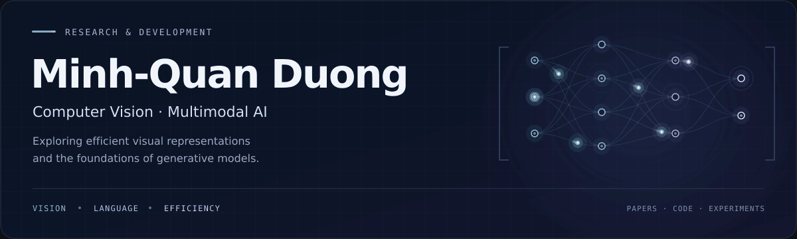

<!--
PROFILE SETUP
Upload README.md and the assets/ folder together to your profile repository.
The displayed banner is assets/profile-header.gif (90 frames, a 5.4-second loop).
The editable vector source is assets/profile-header.svg; changing the source requires re-rendering the GIF.
Contact links are configured. Add real project links in the commented sections below.
No project results, publications, affiliations, or contribution counts are assumed.
-->

  

  <strong>Research interests in efficient multimodal learning and generative modeling.</strong> 
  Paper reading, model experimentation, and application development.

  <a href="#current-focus">Current focus</a> &nbsp; · &nbsp;
  <a href="#research-questions">Research questions</a> &nbsp; · &nbsp;
  <a href="#working-set">Working set</a>

  <a href="mailto:duongquan301@gmail.com">Email</a> &nbsp; · &nbsp;
  <a href="https://www.linkedin.com/in/minh-quan-duong-7780aa158/">LinkedIn</a> &nbsp; · &nbsp;
  <a href="https://scholar.google.com/citations?user=tuCiFxAAAAAJ&amp;hl=vi">Google Scholar</a> &nbsp; · &nbsp;
  <a href="https://orcid.org/0009-0000-9080-8908">ORCID</a>

---

## Turning research questions into experiments

I'm Minh-Quan Duong. My interests lie in computer vision, vision-language models, and efficient inference. I explore how models represent visual information, which information matters for a task, and how to reduce computation while preserving useful capabilities.

Alongside AI, I work on Android applications and study the software foundations behind reliable implementations: algorithms, object-oriented design, and operating systems.

## Current focus

### 01 / Efficient multimodal learning

Studying visual token compression and adaptive token selection in vision-language models, with attention to the balance between task performance, token budgets, and inference cost.

`Visual token compression` `Adaptive selection` `Vision-language models`

### 02 / Generative modeling

Exploring diffusion models and flow matching, including their training objectives, sampling procedures, and opportunities for more efficient image generation.

`Diffusion models` `Flow matching` `Image generation`

### 03 / Applied AI & software development

Exploring how AI can support useful Android applications, while developing a stronger foundation in C++ and software design.

`Android` `C++` `Practical AI applications`

<!-- SELECTED WORK
Place this section above Research questions after adding real repositories.
Use two or three projects and keep each entry specific to your contribution.

## Selected work

### [Project name](https://github.com/YOUR_USERNAME/YOUR_REPOSITORY)

A concise description of the problem and the implemented solution.

**Contribution:** Your role and what you implemented.  
**Evidence:** A measured result, reproducible experiment, or working demonstration.  
**Resources:** [Code](https://github.com/YOUR_USERNAME/YOUR_REPOSITORY) · [Report](https://YOUR_REPORT_URL)

### [Project name](https://github.com/YOUR_USERNAME/YOUR_REPOSITORY)

A concise description of the problem and the implemented solution.

**Contribution:** Your role and what you implemented.  
**Evidence:** A measured result, reproducible experiment, or working demonstration.  
**Resources:** [Code](https://github.com/YOUR_USERNAME/YOUR_REPOSITORY) · [Demo](https://YOUR_DEMO_URL)
-->

## Research questions

| Question | Direction |
| :--- | :--- |
| Which visual tokens are necessary for a given task? | Task-aware selection and adaptive compression |
| How much computation can be removed before performance degrades? | Quality–efficiency trade-offs and inference evaluation |
| How do diffusion and flow-based models differ in practice? | Objectives, sampling behavior, and computational cost |

## Working set

**AI & experimentation** &nbsp; Python · PyTorch  
**Software development** &nbsp; C++ · Android Studio · XML  
**Documentation & version control** &nbsp; LaTeX · Git

<strong>What I look for in a research implementation</strong>

- A clear question and a baseline that makes the comparison meaningful.
- An explicit account of compute requirements and evaluation conditions.
- Ablations that help explain why a method works.
- Code, settings, and limitations that make the result easier to reproduce.

<!-- RECOGNITION
Add confirmed details and references; do not invent an award level or publication status.

## Recognition

- **Award name** — Competition, year. Team and placement. [Reference](https://YOUR_REFERENCE_URL)

## Publications

- **Paper title** — Authors. Venue, year. [Paper](https://YOUR_PAPER_URL) · [Code](https://YOUR_CODE_URL)
-->

---

**Let's compare ideas.** I'm interested in discussions about multimodal efficiency, computer vision, and practical AI applications.

**Contact:** [duongquan301@gmail.com](mailto:duongquan301@gmail.com)
